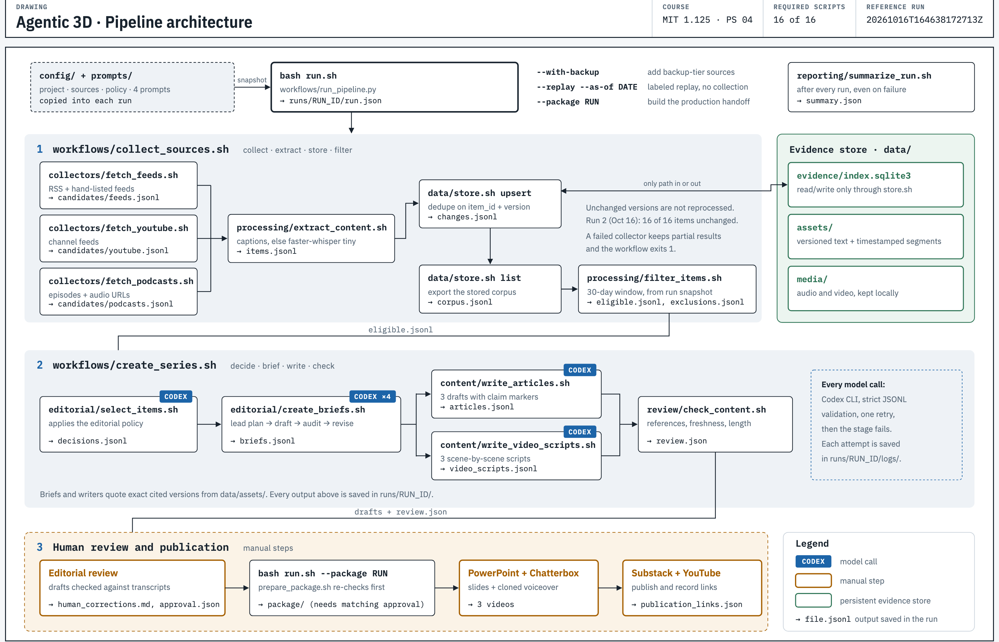
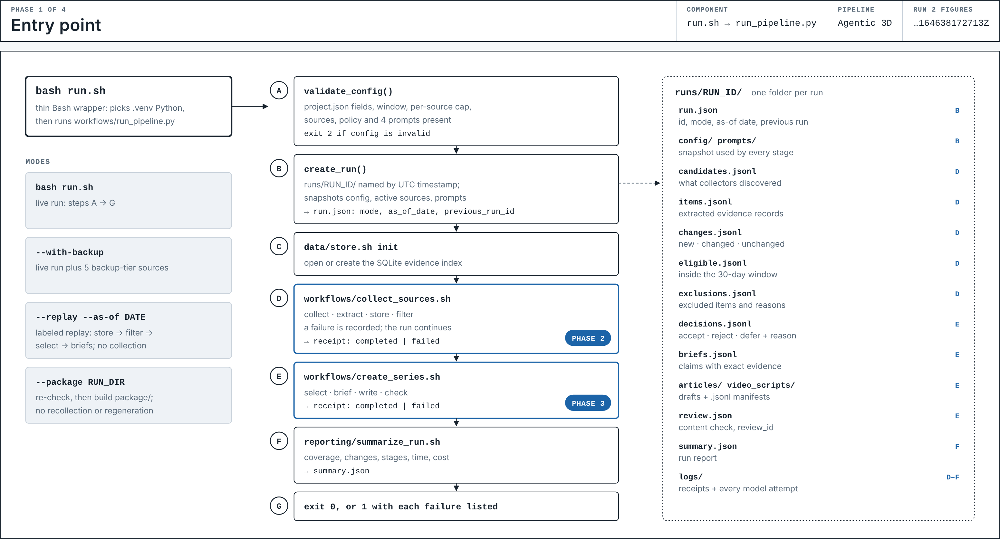
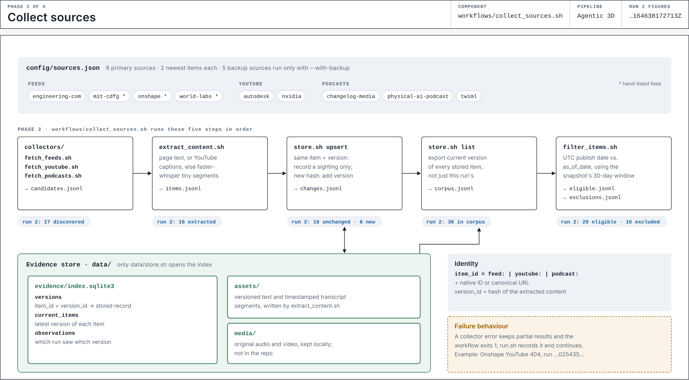
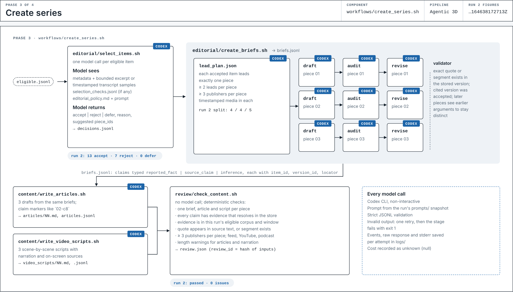
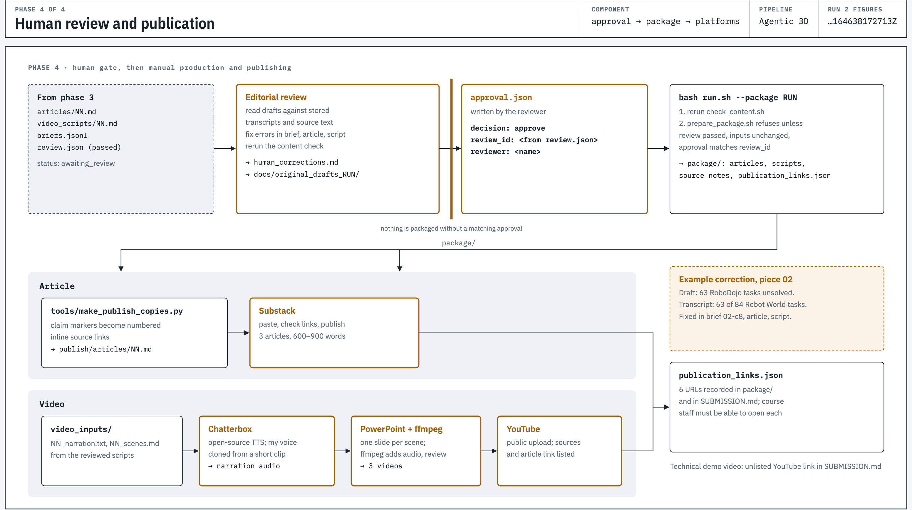

# Problem Set 4 Student Submission

**Student:** Steph Xu  
**GitHub repository:** https://github.com/stephxu96/agentic_ai_pset_04

## Topic and Audience

- **Publication name:** Agentic 3D
- **Topic:** Frontier AI for 3D modeling, CAD, and manufacturing design (design for manufacturing, process planning, quoting, and production-ready geometry), plus intelligent systems that act in physical space, including robotics. AI-native startups are covered when there is substantive evidence.
- **Audience and assumed knowledge:** Technical product managers and engineering leaders deciding where to build on frontier models for spatial, geometric, and manufacturing-design work. They understand LLMs and basic 3D and CAD concepts (parametric vs. mesh, simulation) but do not follow benchmarks or demos daily.
- **Central question:** Which spatial, geometric, and manufacturing-design capabilities moved from demo toward dependable this month, and does the evidence behind each claim match what it claims? When relevant AI-native startups appear, what are they shipping?
- **Scope and exclusions:** 3D modeling, CAD, and manufacturing design lead the series; robotics supports it. Excluded: animation and game content, pure image or video generation, datacenter and training infrastructure, investment advice, and funding news used as evidence (see [`config/editorial_policy.md`](config/editorial_policy.md)).
- **Reason for readers to return:** Each issue applies one test to the month's announcements: what was actually checked, by whom, and under what conditions. Readers get a short, sourced verdict on which claims hold up, without following every demo themselves.

## Published Series

| Piece | Title | Substack article | YouTube video |
| --- | --- | --- | --- |
| 1 | AI Now Writes Design Features and Sets Up Physics Tests | [Article](https://stepuni.substack.com/p/ai-now-writes-design-features-and) | [Video](https://www.youtube.com/watch?v=pICJnOCUzMc) |
| 2 | An AI-Made Design File Is Not a Finished Design | [Article](https://stepuni.substack.com/p/an-ai-made-design-file-is-not-a-finished) | [Video](https://www.youtube.com/watch?v=IdhPfQE0yzY) |
| 3 | CAD Engineering Teams Should Try AI First Where Mistakes Are Easy to Fix | [Article](https://stepuni.substack.com/p/start-where-ai-mistakes-are-easy) | [Video](https://www.youtube.com/watch?v=06Vi4mkEthE) |

**Separate technical demonstration video:** [YouTube (unlisted)](https://www.youtube.com/watch?v=kdQgnl_vYYQ)

## Setup and Execution

### Tools and versions

| Tool | Version used | Purpose |
| --- | --- | --- |
| macOS, Bash 3.2 | | Scripts also run on Linux |
| Python | 3.12.8, in `.venv` | All pipeline helpers |
| `faster-whisper` | 1.2.1 (`tiny` model) | Transcripts when captions are missing |
| `av` | below 19 | Required by faster-whisper 1.2.1 |
| `yt-dlp` | 2026.8.19 | YouTube and podcast media |
| Codex CLI | 0.155.1 | The only model provider: selection, briefs, articles, video scripts |
| ffmpeg | 9.0.2 | Audio handling and video rendering |

The model is whatever Codex CLI uses by default; Codex does not report its name, so runs record `"default, name not reported"`. There are no direct API calls.

### Installation

```bash
python3 -m venv .venv
.venv/bin/pip install -r requirements.txt
brew install ffmpeg           # or your platform's package manager
# Install Codex CLI and sign in once with `codex login`
```

### Credentials and environment variables

No credentials are stored in the repository. Codex CLI uses its own sign-in. These optional variables override defaults and hold no secrets:

| Variable | Default | Effect |
| --- | --- | --- |
| `CODEX_BIN` | `codex` on `PATH` | Path to the Codex CLI |
| `YT_DLP_BIN` | `yt-dlp` on `PATH` | Path to yt-dlp |
| `BRIEF_POLICY_SOURCE` | `run_snapshot` | `live` makes the brief stage read `config/` instead of the run's snapshot |

### Configuration

Each run copies these into `runs/RUN_ID/` so it keeps the instructions it ran under:

- `config/project.json`: publication name, topic, audience, central question, `freshness_window_days` (30), `max_items_per_source` (2), `whisper_model`.
- `config/sources.json`: one record per source, with `source_id`, `publisher_id`, `kind` (`feed`, `youtube` or `podcast`) and `url`. `"tier": "backup"` sources run only with `--with-backup`; `"warn_on_404": true` logs a 404 as a warning instead of a failure.
- `config/editorial_policy.md`: the policy given to the model at selection and synthesis.
- `prompts/`: the four prompts (selection, briefs, articles, video scripts).

### Commands

```bash
bash run.sh                                   # live run
bash run.sh --with-backup                     # live run plus backup-tier sources
bash run.sh --replay --as-of 2026-10-12       # labeled replay from the store; optional --through eligible|selection|briefs
bash run.sh --package runs/20261016T164638172713Z   # re-check, then build package/ (needs a matching approval.json)
python3 tests/validate_run.py runs/RUN_ID     # validate a run's artifacts
bash tests/run_tests.sh                       # test suite
```

### Freshness window

This project uses the assignment's standard 30-day publication window (`freshness_window_days: 30` in `config/project.json`). The pipeline calculates the inclusive window from the run's configuration snapshot and records each item's age in days.

## Architecture and Manual Handoffs



`bash run.sh` snapshots the configuration and prompts into `runs/RUN_ID/`, then runs two workflows: `collect_sources.sh` (collect, extract, store, filter) and `create_series.sh` (select, brief, write, check). Codex CLI is called only in selection, briefs, articles and video scripts (marked CODEX). Evidence lives in `data/`: the SQLite index behind `data/store.sh`, versioned text and transcript segments in `data/assets/`, and local media in `data/media/`. Every stage output and model attempt is saved in the run folder. Publishing starts only after a human approval that matches the content review.

The four phases in detail:

#### 1. Entry point



#### 2. Collect sources



#### 3. Create series



#### 4. Human review and publication



Interactive versions: open [`docs/architecture/architecture_overview.html`](docs/architecture/architecture_overview.html) and [`docs/architecture/architecture_phases.html`](docs/architecture/architecture_phases.html) in a browser.


### Manual handoffs

| Step | Input files | What happens | Output |
| --- | --- | --- | --- |
| 1. Editorial review | `runs/RUN_ID/articles/NN.md`, `video_scripts/NN.md`, `briefs.jsonl`, stored transcripts | I read the drafts against the stored sources and correct errors. Originals are kept in `docs/original_drafts_RUN_ID/`. | Corrected drafts; `runs/RUN_ID/human_corrections.md` |
| 2. Video production | `runs/RUN_ID/video_scripts/NN.md` (narration, visual directions, sources) | One PowerPoint deck per piece, one slide per scene, with the narration and source URLs in the speaker notes. Each deck opens with a title slide and a spoken executive summary. The voiceover is generated with Chatterbox (Resemble AI's open-source text-to-speech) as a clone of my voice from a 17-second recording, run locally. ffmpeg combines the slides and voiceover into a 1080p MP4. Each video says its narration is AI-generated. | `runs/RUN_ID/presentations/`: decks, `audio/`, `video/`, `preview/`, `timing_cues.md` |
| 3. Substack | `runs/RUN_ID/publish/articles/NN.md` (from `tools/make_publish_copies.py`, which turns claim markers into source links) | I edit each article under my writing rules, then paste it into Substack from `publish/substack/NN.html`. | Three article URLs (above) |
| 4. YouTube | `presentations/video/pieceNN.mp4`; the "Video description" section of `video_scripts/NN.md` | I upload each video and paste the description, which holds the article link and source references. | Three video URLs (above) |

## Evidence and Runs

Everything needed to inspect the workflow is in the repository: the evidence index (`data/evidence/index.sqlite3`), versioned source text and transcript segments (`data/assets/`), and each run's folder in `runs/`. Each run folder holds `candidates.jsonl`, `items.jsonl`, `changes.jsonl`, `eligible.jsonl`, `exclusions.jsonl`, `item_ages.jsonl`, `decisions.jsonl`, `briefs.jsonl`, the drafts, `review.json`, `summary.json` and `logs/` (a receipt and the raw output for every model attempt). Downloaded audio and video (`data/media/`) are not committed because they are other publishers' material. Each item's `url` and `media_url` are recorded in `runs/RUN_ID/items.jsonl`, and a live run downloads them again.

| Run | Actual date | Run artifacts and logs | Elapsed time | Approximate cost |
| --- | --- | --- | --- | --- |
| First live run | 2026-10-16 | [`runs/20261016T153413218193Z/`](runs/20261016T153413218193Z/) | 864 s (14 min) | Unknown: Codex CLI does not report cost |
| Second live run | 2026-10-16 | [`runs/20261016T164638172713Z/`](runs/20261016T164638172713Z/) | 1,299 s (22 min) | Unknown: cost recorded as `null` for every model stage |

Elapsed time runs from `run.json` → `started_at` to the end of the run's workflows. Codex CLI does not report spend, so every stage records cost as `null`.

### How the pipeline developed

**1. Building and testing (Oct 15 to 16).** The earlier folders in `runs/` are build-and-test runs. The Oct 15 test run (`runs/20261015T202519414242Z/`) took policy version 1 through selection: 22 items discovered, 6 accepted, 9 rejected, 4 deferred. It showed me that my first topic was too narrow and that manufacturing news moves slowly, so there was little to work with. The AI deferred timestamped podcasts with quotable passages and treated vendors' own claims as too weak to use. The run also stopped at the brief stage on a Codex CLI error (`logs/create-briefs-failed-20261015T204839588941Z.json`), which I fixed. The other test runs exercised failure recovery and the labeled replays described below.

**2. Rethinking what matters to the audience.** I asked what actually matters to technical product and engineering leaders: what vendors are shipping, labeled as their claims, and manufacturing-design decisions where AI produces or checks geometry, process or cost. Policy version 2 widens the scope to manufacturing design, accepts commercial claims when they are labeled, narrows deferral, and makes startups optional. I changed the sources: added `engineering-com-ai`, `onshape-blog`, `twiml-ai-podcast` and `world-labs`; removed `cadalyst`, `xometry-blog` and `yt-onshape`. I kept the assignment's standard 30-day window and capped each source at 2 items. Both live runs use this policy.

**3. First live run (Oct 16, 15:34).** With the new policy, the four podcasts deferred in testing were accepted, and selection produced 13 accepted, 7 rejected and 0 deferred items. The run wrote all three briefs, articles and scripts. But the three pieces made one argument in three forms: "CAD AI Moves Into Engineering Workflows, While Verification Stays Separate", "The Check Is the Capability", and "Adopt the Workflow, Not the Unchecked Output".

**4. One prompt change.** I revised the brief prompt (`prompts/create_briefs.md`, "Keep the three pieces distinct"). Each piece must argue something the other two do not, have its own synthesis, and lead with at least two items the others do not lead with. Policy, sources and evidence stayed the same.

**5. Second live run (Oct 16, 16:46).** The same 20 eligible items produced three distinct pieces: what changed (AI at two engineering handoffs), which claims hold up (a CAD file passing a mass check is not a finished design), and what to do (pilot where mistakes are easy to fix). My review against the stored transcripts found and fixed a misattributed result (`human_corrections.md`). I then rewrote the articles under my writing rules, produced the videos, published the series, recorded approval, and packaged the run (`approval.json`, `package/`; status `ready_for_production`).

| Count (`summary.json`) | First live run | Second live run |
| --- | ---: | ---: |
| Discovered / extracted | 17 / 16 | 17 / 16 |
| New / unchanged | 0 / 16 | 0 / 16 |
| Eligible / excluded | 20 / 16 | 20 / 16 |
| Accepted / rejected / deferred | 13 / 7 / 0 | 13 / 7 / 0 |
| Articles and scripts | 3 and 3 | 3 and 3 |

No meaningful new material appeared between the two live runs, 72 minutes apart: the counts are identical, and the only change is the brief prompt.

### Duplicate handling

The store keys each item by `item_id` plus `version_id` (a hash of its content). A repeat sighting is logged as an observation; nothing is extracted or stored twice. By the live runs, the store already held every item from testing: both live runs found all 16 extracted items unchanged and processed none of them again (`summary.json` → `counts`, `duplicate_observations`; `changes.jsonl`).

### Date-window checks

`item_ages.jsonl` records each item's age in days against the run's `as_of_date`. `exclusions.jsonl` records why an item was left out; in each live run: 14 from inactive sources and 2 outside the 30-day window.

### Collection failure and recovery

A real failure during testing: Onshape's YouTube feed returned HTTP 404 (`runs/20261016T025435190699Z/logs/`, `collectors/fetch_youtube.sh` receipt). The collector logged it, kept the other channels' results and exited 1; the run continued with the stage marked failed. The source is optional, so it is now marked `"warn_on_404": true` in `config/sources.json`, while any other failure still blocks.

### Labeled replays

Three replays read the stored items as of earlier dates: `runs/20261016T044609285249Z/` (as of 2026-09-25), `runs/20261016T044609488268Z/` (2026-10-02) and `runs/20261016T044609692224Z/` (2026-10-12). Each `run.json` has `"mode": "replay"` and a `replay_note` saying it is a labeled simulation, not a live run. As the as-of date moves forward, items withheld as too new enter the window: 5, then 10, then 20 eligible items.

### Trace of one published claim (02-c1)

| Step | Record |
| --- | --- |
| Published sentence | Article 2: "In the first test, it opened a downloaded STEP file in Fusion, assigned a material, and found the mass exactly right." (`runs/20261016T164638172713Z/publish/articles/02.md`) |
| Brief | `runs/20261016T164638172713Z/briefs.jsonl`, piece 02, claim `02-c1` (`reported_fact`): Engineering.com reported that in its first TooTallToby drawing test it imported a Backflip STEP file into Fusion, applied material, checked mass, and found the result exactly correct. |
| Editorial decision | `decisions.jsonl`: `feed:https://www.engineering.com/?p=151563`, `accept`. Reason: an independent engineering publication ran its own checks, imported the STEP files, applied 1060 aluminum and matched the target mass. |
| Source version | `item_id` `feed:https://www.engineering.com/?p=151563`, `version_id` `90e3adc0a87a45dc20689ae62db7125fe378f8191522f5954fae4ace5e96c803` |
| Exact passage | "I can verify that Backflip got it exactly correct." (`data/assets/feed_https_www.engineering.com_p_151563/90e3adc0….txt`) |

The content check (`review/check_content.sh`) repeats these lookups without a model. The second live run's `review.json` passed with no issues (`review_id` `ae074c7b…`), `approval.json` matches it, and `bash run.sh --package` built `package/` with the six publication links; the run's status is `ready_for_production`.

## Editorial Review

- Policy: [`config/editorial_policy.md`](config/editorial_policy.md). Version 1 is in the Oct 15 test run (`runs/20261015T202519414242Z/config/`); version 2 is in both live runs (`runs/20261016T153413218193Z/config/`, `runs/20261016T164638172713Z/config/`).
- Prompts: [`prompts/`](prompts/), snapshotted in each run's `prompts/`.
- Item-by-item review, policy before and after, corrections and approval: [`docs/editorial_review.md`](docs/editorial_review.md).

**Main factual correction:** in piece 2, the draft credited a "63 of 84 tasks unsolved" result to RoboDojo. The episode transcript ties it to the Robot World paper. The error began in the AI's selection reason, and I fixed it in the brief, article and script (`runs/20261016T164638172713Z/human_corrections.md`).

### Human touch: my writing rules

Every article is drafted under my personal writing rules, set out in [`prompts/write_articles.md`](prompts/write_articles.md) under "The author's writing rules". They are inspired by George Orwell's six rules in "Politics and the English Language" (1946), adapted for technical writing about engineering evidence:

| My rule | Orwell's rule |
| --- | --- |
| Omit unnecessary words. | "If it is possible to cut a word out, always cut it out." |
| Prefer simple, precise language over needlessly complex wording. | "Never use a long word where a short one will do." |
| Use active voice when it makes the actor and action clearer. | "Never use the passive where you can use the active." |
| Use technical terms only when necessary; define them for the intended audience. | "Never use a foreign phrase, a scientific word, or a jargon word if you can think of an everyday English equivalent." |
| Avoid clichés and decorative metaphors that do not advance the argument. | "Never use a metaphor, simile, or other figure of speech which you are used to seeing in print." |
| Break these rules when doing so improves precision, clarity, or disciplinary fit. | "Break any of these rules sooner than say anything outright barbarous." |

My main change from Orwell is the exception. His sixth rule allows breaking the others only to avoid barbarous phrasing; mine also allows it for precision and disciplinary fit. For example, "boundary conditions" and "mesh" stay because this audience uses them.

## Reflection

**Insight.** The system connected two announcements a reader would likely see separately. Onshape's FeatureScript server and SimScale's agent both work from "one prompt", but they sit at different steps with different checking burdens: a generated CAD feature can be checked against its design rules, while a simulation setup must also be checked against the engineering question. That became the main argument of piece 1 (inference claim 01-c7).

**Failure.** The content check proves that a quote exists in the source, not that the model read it correctly. In piece 2, the AI's selection reason credited a 63-of-84 result to RoboDojo; the transcript ties it to the Robot World paper. The error carried into the brief, article and script, and I fixed all three by hand.

**Next improvement.** Add a human source review right after selection, before briefs are written, so a misread source is caught once instead of in three drafts.

**Tradeoff.** Every model call goes through Codex CLI with strict JSONL validation and one retry. Each stage reads and writes files, invalid output is rejected, and every attempt is saved, so any run can be inspected and replayed. A publication built on tracing evidence needs that. The cost: spend is recorded as unknown, and I read failures in raw JSON rather than through a friendlier interface.
